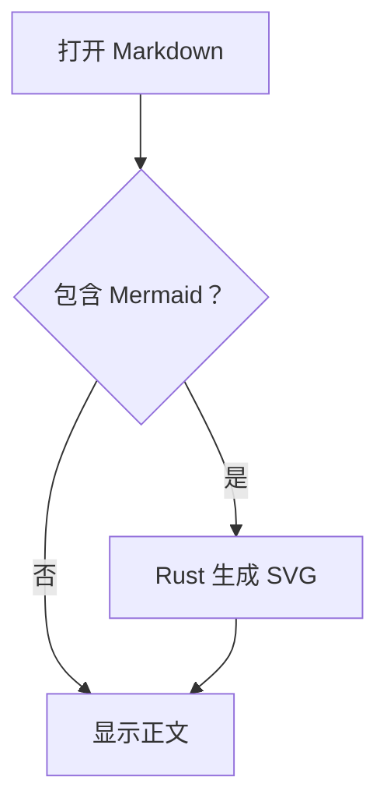
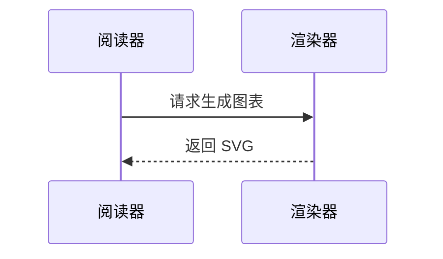
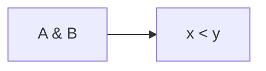
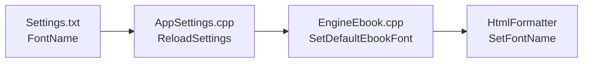

# Mermaid 原生渲染测试

## 中文流程图



## 时序图



## 特殊字符



## 无效语法应保留代码

```mermaid
this is not a diagram
```

## 普通代码应保持原样

```cpp
const char* diagram = "flowchart LR; A-->B";
```

图表后的正文应正常显示。

## 多行节点文字不应重叠


