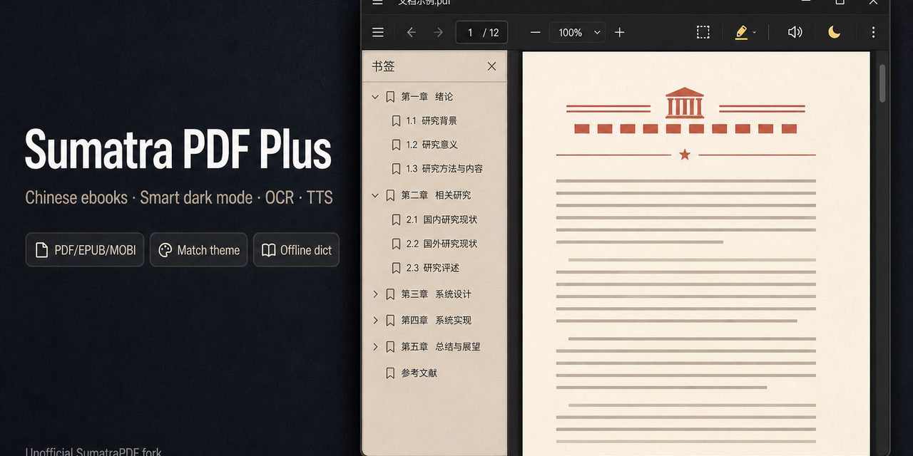

# Sumatra PDF Plus

Windows 文档阅读器，在 SumatraPDF 基础上增强中文电子书阅读、扫描件 OCR、PDF 页面整理、目录识别、批注与朗读。
A Windows document reader based on SumatraPDF, with Chinese ebook improvements, local OCR, PDF page editing, table-of-contents recognition, annotations and read aloud.

**非官方社区增强版 / Unofficial fork** · 与 [sumatrapdfreader.org](https://www.sumatrapdfreader.org/) 无隶属关系 / Not affiliated with the official project.

**当前版本 / Current release: [3.7.44](https://github.com/dengxibo/sumatrapdf-plus/releases/tag/3.7.44)** · [下载 / Downloads](https://github.com/dengxibo/sumatrapdf-plus/releases/latest) · [更新记录 / Changelog](docs/md/Version-history.md) · [反馈 / Issues](https://github.com/dengxibo/sumatrapdf-plus/issues)



## 主要功能 · Features

| 功能 / Feature | 说明 / What it does |
| --- | --- |
| 阅读与主题 / Reading and themes | PDF、EPUB、MOBI、Markdown、Word 文档及 PPTX 文字内容；四种界面主题，文档原稿色或匹配主题色。 / Multiple formats, four interface themes, original or theme-matched document colors. |
| 扫描件 OCR / Local OCR | 翻页自动识别、全文识别、框选识别、保存可搜索 PDF。 / Recognize pages while reading, whole documents or selected regions; save searchable PDFs. |
| 手动调整页面 / Page adjustment | 倾斜校正、旋转、镜像、裁切比例锁定、批量逐页预览与本页单独调整。 / Deskew, rotate, flip and crop with ratio locks, batch previews and per-page overrides. |
| 缩略图页面管理 / Thumbnail page editing | 多选、复制、剪切、粘贴、删除、拖动排序、撤销；插入和提取页面。 / Multi-select, copy/cut/paste, delete, drag to reorder, undo, insert and extract pages. |
| AI 目录识别 / AI table of contents | 从印刷目录或正文生成书签，支持 API 与网页 AI 工作流程，导入前可校准。 / Generate bookmarks from printed contents or body text, using an API or web AI workflow, with review before importing. |
| 批注 / Annotations | 划词工具栏、笔记与页面内自由文本编辑。 / Selection markup, notes and inline free-text editing. |
| 离线查词 / Offline dictionary | 双击查词，支持英汉、汉语词典及繁体 PDF 查词。 / Double-click lookup, with English–Chinese, Chinese and Traditional Chinese PDF support. |
| 朗读 / Read aloud | 系统语音逐词高亮，EPUB 3 内置录音共用朗读控制条。 / Word-highlighted text-to-speech and EPUB 3 recorded narration on one control bar. |

常见格式：PDF、EPUB、MOBI、AZW/AZW3、FB2、CHM、CBZ/CBR、DjVu、XPS、Markdown（MD）、DOC、DOCX 等，也可提取阅读 PPTX 的文字内容。扫描 PDF、DjVu、图片和漫画可使用本地 OCR。
Supported formats include PDF, EPUB, MOBI, AZW/AZW3, FB2, CHM, CBZ/CBR, DjVu, XPS, Markdown, DOC and DOCX, plus text-oriented reading of PPTX files. Local OCR also works with scanned documents, images and comics.

## 下载与开始使用 · Download and get started

### 123 网盘 · 推荐

① [主程序 + 带发音中英词典](https://1828067303.share.123pan.cn/123pan/2cwUjv-IWQVd)

② [仅主程序](https://1828067303.share.123pan.cn/123pan/2cwUjv-A5xyd)

### GitHub · 源码 / 备用下载

- [源码与主页说明](https://github.com/dengxibo/sumatrapdf-plus)
- [备用下载](https://github.com/dengxibo/sumatrapdf-plus/releases)

- **首次使用：** 从上方 123 网盘选择所需程序包，或在[发布页](https://github.com/dengxibo/sumatrapdf-plus/releases/latest)选择完整程序包（如有提供），解压后运行 `SumatraPDF-Plus.exe`。
  **First use:** choose a complete package from the [release page](https://github.com/dengxibo/sumatrapdf-plus/releases/latest), when available, and run `SumatraPDF-Plus.exe` after extraction.
- **已有完整目录：** 退出程序后，可用新版 [EXE](https://github.com/dengxibo/sumatrapdf-plus/releases/download/3.7.44/SumatraPDF-Plus.exe) 替换旧文件；保留原有配置及配套数据。独立 EXE 不包含全部可选资源。
  **Updating an existing folder:** close the app and replace the executable with the new [EXE](https://github.com/dengxibo/sumatrapdf-plus/releases/download/3.7.44/SumatraPDF-Plus.exe), keeping settings and supporting data. The standalone EXE does not contain all optional resources.

| 同目录资源 / Folder beside the EXE | 用途 / Purpose |
| --- | --- |
| `fonts` | 配套字体 / Bundled fonts |
| `ocr` | 本地 OCR 模型和 `onnxruntime.dll` / Local OCR models and runtime |
| `dict` | 用户词典 `.idx` / `.dat`，可带音频数据 / User dictionary files and optional audio |
| `opencc` | 繁体 PDF 查词所需的转换数据 / Conversion data for Traditional Chinese PDF lookup |

通过工具栏切换主题、文档颜色、自动 OCR、查词和朗读；在选项窗口调整阅读及识别设置。
Use the toolbar for themes, document colors, automatic OCR, lookup and read aloud; configure reading and recognition in Options.

## PDF 页面整理与裁切 · PDF page editing and cropping

### 手动调整页面 · Manually adjust pages

在 PDF 页面上右键选择“手动调整页面”。左侧查看预览，右侧设置倾斜角度、参考网格、旋转、镜像和裁切；应用范围可选当前页、全部页或指定页。
Right-click a PDF page and choose **Manually Adjust Pages**. Preview on the left and set deskew, grid, rotation, flips and cropping on the right. Choose the current page, all pages or a specified range.

- **锁定比例：** 自由、锁定当前框、原页比例、A4 竖向/横向、1:1、4:3、3:4；拖动锚点缩放，拖动框内区域移动。
  **Aspect ratios:** free, current crop, original page, A4 portrait/landscape, 1:1, 4:3 and 3:4. Drag handles to resize or the inside to move.
- **批量检查：** 先设统一框，再用预览下方的上一页、下一页和页码框遍历所选范围；同尺寸扫描件共用固定位置和尺寸。
  **Batch review:** set a shared crop, then browse the selected range with the preview navigation controls. Same-size scans share a crop at the same physical position and size.
- **单页例外：** 某页扫描位置偏移时，勾选“本页单独调整”；翻页后可继续分别调整各页。取消勾选则该页恢复统一框。
  **Per-page overrides:** enable separate adjustment for a misaligned scan. Keep it enabled to adjust successive pages independently; uncheck to restore that page to the shared crop.
- **边界检查：** 裁切框越界时标明问题，应用前检查全部目标页；需修正后才能应用。手动裁切与自动裁切互斥。
  **Bounds checking:** out-of-page crops are flagged and all target pages are checked before applying. Manual and automatic cropping are mutually exclusive.

翻页仅用于预览，不修改 PDF，也不改变主窗口的当前页。“应用”将调整写入内存，标签出现未保存红点；手工保存才写回文件，关闭时可选择不保存。
Preview navigation changes neither the PDF nor the main window's current page. **Apply** changes the in-memory document and shows an unsaved indicator. Save explicitly to write the file, or discard changes when closing.

### 缩略图侧栏 · Thumbnail sidebar

打开缩略图侧栏，使用 `Ctrl` 多选、`Shift` 连选，再右键操作；选中页面也可拖动排序。
Open the thumbnail sidebar, use `Ctrl` or `Shift` to select pages, then right-click for actions or drag the selection to reorder it.

| 操作 / Action | 使用方法 / How |
| --- | --- |
| 全选 / Select all | `Ctrl+A` |
| 复制、剪切、粘贴 / Copy, cut, paste | `Ctrl+C` / `Ctrl+X` / `Ctrl+V`；可在 PDF 标签之间复制页面 / Copy pages between PDF tabs |
| 删除 / Delete | `Delete`；至少保留一页 / At least one page must remain |
| 撤销页面编辑 / Undo page edit | `Ctrl+Z` |
| 插入 / Insert | 右键插入 PDF、图片文件或剪贴板图片 / Right-click to insert a PDF, image file or clipboard image |
| 提取 / Extract | 右键将选中页另存为新 PDF / Right-click to save selected pages as a new PDF |

这些快捷键在缩略图侧栏获得焦点时生效。对当前文档的页面编辑先留在内存，手工保存后落盘；提取页面会单独创建输出文件。
These shortcuts apply while the thumbnail sidebar has focus. Page edits remain in memory until saved; extraction creates a separate output file.

有未保存 OCR 结果时，先保存识别文字再进行页面结构编辑。插入源 PDF 目前需未加密，多帧图片仅插入首帧；复杂表单关系及跨文档内部跳转链接有支持限制。详见[页面管理说明](docs/thumbnail-page-management-2026-10-11.md)。
Save pending OCR text before changing page structure. Source PDFs must currently be unencrypted; multi-frame images insert their first frame. Complex form relationships and internal cross-document links have limitations. See the [page-management notes](docs/thumbnail-page-management-2026-10-11.md).

## Markdown、Word 与演示文稿 · Markdown, Word and presentations

除了 PDF 和电子书，也可以阅读 Markdown（`.md`）、Word（`.doc` / `.docx`），并提取 PPTX 的文字内容阅读。
Read Markdown (`.md`) and Word (`.doc` / `.docx`) documents, and extract PPTX text for reading.

- **Markdown：** 支持标题、表格、代码块等内容的阅读排版，并适配主题。
  **Markdown:** reading layouts for headings, tables and code blocks, with theme support.
- **Word：** 可打开 DOCX；旧版 DOC 通过本机 Microsoft Word 转换后阅读，需要安装 Word。
  **Word:** open DOCX directly; legacy DOC uses Microsoft Word on the computer for conversion and requires Word to be installed.
- **PPTX：** 以提取内容的方式阅读文字，适合查看讲义和演示文稿要点；不等同于 PowerPoint 的原版幻灯片、动画或放映效果。
  **PPTX:** read extracted content for slide notes and key points, rather than a faithful PowerPoint slide or animation presentation.

这些功能用于阅读，Office 转换后的布局与原应用可能不同。
These are reading features; converted Office layouts may differ from the original application.

## 扫描件 OCR 与目录 · OCR and table of contents

**本地 OCR：** 使用 RapidOCR / PP-OCR，模型位于 `ocr` 文件夹，识别过程离线运行。识别后可搜索、选字、查词、朗读和提取书签。
**Local OCR:** RapidOCR / PP-OCR runs offline with models in the `ocr` folder. Recognized text can be searched, selected, looked up and read aloud, and used for bookmark extraction.

- **自动 OCR：** 阅读或搜索扫描页时识别；工具栏可开关。
  **Auto OCR:** recognize scanned pages while reading or searching; toggle it on the toolbar.
- **识别所有扫描页：** 提供“快速”和“精确”两种方式。
  **Recognize all scanned pages:** choose Fast or Accurate.
- **自动保存：** 独立开关，默认关闭。关闭时识别结果保留在内存，由用户手工保存；开启后，全文识别或目录提取完成会保存当前 PDF，相关覆盖操作会提示确认。
  **Auto-save:** a separate toggle, off by default. With it off, results stay in memory until saved manually; with it on, whole-document OCR or outline extraction saves the current PDF, with confirmation for relevant overwrite operations.
- **框选识别：** 按住 `Alt` 用鼠标拖选，或按 `Ctrl+Shift+X` 后拖选区域，识别文字复制到剪贴板。
  **Region OCR:** hold `Alt` and drag with the mouse, or press `Ctrl+Shift+X` and select a region; recognized text is copied to the clipboard.

**AI 目录识别：** 支持多套 OpenAI 兼容 API 配置、模型筛选和请求并发设置，也可使用网页 AI 工作流程。可从印刷目录识别，或在没有独立目录页时从正文生成；导入前可校准目录。
**AI table of contents:** use multiple OpenAI-compatible API profiles, model filtering and concurrency settings, or the web AI workflow. Recognize printed contents or generate an outline from body text, then review before importing.

AI API 模式会向所配置的平台发送识别请求，与本地离线 OCR 不同。
AI API mode sends recognition requests to your configured provider, separately from offline local OCR.

[OCR 使用说明 / OCR guide](docs/md/OCR.md) · [AI 目录配置 / AI TOC setup](docs/ai-toc-api.md)

## 电子书阅读：选字体、改字号，不用折腾配置文件

阅读 EPUB、MOBI 等可以重新排版的电子书，字体和字号会直接影响阅读体验。这也是 Plus 持续改进的一块。

**中英文字体在选项里直接选。** 不用打开配置文件查字段、手工填写字体名称；在选项窗口分别选择中文字体和英文字体，确认后即可应用到电子书阅读。中文、西文和混排内容都能按自己的习惯设置。

**字号可以边看边调，调整后立即看到重新排版的结果。** 这与固定版式 PDF 的整页缩放不同：电子书会根据字号重新换行、分页。想把字放大一点，不必反复改配置、重新打开文件试效果；调整字号时也会尽量保留正在阅读的位置。

**大型 EPUB 的打开和排版做了明显加速。** 不只关注首次打开，也优化了调整字号后的重新排版和阅读位置恢复，减少大书操作时的等待。具体耗时仍与文件大小、章节结构、图片数量和电脑配置有关。

此外也持续改善中文字体、图文混排、目录跳转，以及 MOBI / AZW 等电子书的阅读体验。

Choose Chinese and English fonts directly in Options, then apply them to reflowable ebooks. Change the font size while reading and see the text reflow immediately, with reading-position restoration. Large EPUB opening, relayout and position recovery have been accelerated; timings depend on the book and computer.

## 文档暗黑模式 · Dark document reading

深色界面不等于深色阅读：菜单和工具栏变暗了，如果 PDF 页面仍然是大块白底，夜间阅读时依然很亮。Plus 重点处理的是**文档本身的显示颜色**。

**PDF 正文、扫描页和可重排电子书都可以匹配主题显示。** 文字和页面底色随主题调整，同时对图片、照片和彩色内容做保护处理，尽量保留辨识度。也可以切回原稿颜色，查看文档本来的样子。

这属于阅读时的显示处理，**不会因此改写 PDF 的原始颜色**。图片保护效果会受文档结构影响，遇到特殊页面可以切回原稿对照。

浅色阅读也有区别：除了中性白色，还有暖色纸张风格，让页面、背景和界面处在相近色系，同时保持层次。

Theme-matched colors apply to document content, including PDF text, scanned pages and reflowable ebooks, with image and color protection. Switch to original colors whenever needed. This changes the reading display, not the PDF's stored colors; results depend on the document structure. Light-Warm also offers a warm paper-like reading palette.

## 阅读、批注与主题 · Reading, annotations and themes

- **四种主题：** Light-Warm、Light-White、Dark-Dracula、Dark-Black。文档颜色可保留原稿或匹配主题；菜单、侧栏、输入框和常用提示框随主题配色。
  **Four themes:** Light-Warm, Light-White, Dark-Dracula and Dark-Black. Preserve original document colors or match the theme; menus, sidebars, inputs and common dialogs follow the interface theme.
- **批注：** PDF 划词工具栏支持高亮、下划线、删除线与 Ask AI；自由文本可直接在页面上输入、双击编辑，`Ctrl+Enter` 提交、`Esc` 取消。
  **Annotations:** selection tools for highlights, underlines, strikeouts and Ask AI. Edit free text directly on the page; double-click to edit, `Ctrl+Enter` to commit, `Esc` to cancel.
- **离线查词：** 将词典放入 `dict`，启用查词后双击正文词语。高级设置 `OfflineDictionaryPath` 可指定其他目录；繁体 PDF 查词需 `opencc`。
  **Offline lookup:** place dictionaries in `dict`, enable lookup and double-click a word. Use `OfflineDictionaryPath` for another folder; Traditional Chinese PDF lookup needs `opencc`.
- **朗读：** 工具栏喇叭可开始、暂停和继续；支持从页首、光标或选区开始。系统语音逐词高亮，EPUB 3 录音也使用同一控制条。
  **Read aloud:** start, pause and resume from the speaker button; begin at the page top, cursor or selection. TTS highlights words; EPUB 3 narration uses the same bar.
- **阅读设置：** 可调整窗口大小的选项页、垂直滚轮行数及多显示器 DPI 适配。
  **Reading settings:** resizable Options, configurable vertical wheel lines and per-monitor DPI support.

[朗读说明 / Read-aloud guide](docs/md/Read-Aloud-TTS.md)

## 配置与编译 · Settings and building

配置文件为 `SumatraPDF-settings.txt`：便携版位于 EXE 同目录，安装版位于 `%LOCALAPPDATA%SumatraPDF`。配置注释须独立成行，以 `#` 开头。
Settings are stored in `SumatraPDF-settings.txt`, beside the portable EXE or under `%LOCALAPPDATA%SumatraPDF` for installed copies. Put `#` comments on their own lines.

当前构建脚本使用 Windows、Visual Studio 2026 C++ 工具链和 [Bun](https://bun.sh)。
The current build scripts use Windows, the Visual Studio 2026 C++ toolchain and [Bun](https://bun.sh).

```powershell
bun ./cmd/build.ts          # Debug   -> out/dbg64/SumatraPDF-Plus.exe
bun ./cmd/build-release.ts  # Release -> out/rel64/SumatraPDF-Plus.exe
```

构建脚本也会复制配套字体、OpenCC 数据与 OCR 资源。贡献者说明见 [agents.md](agents.md)。
Build scripts also copy supporting fonts, OpenCC data and OCR resources. See [agents.md](agents.md) for contributor instructions.

## 反馈与许可 · Feedback and license

请在[本仓库](https://github.com/dengxibo/sumatrapdf-plus/issues)反馈 Plus 版本问题，不要提交到官方 SumatraPDF 的问题列表。请附版本、文件类型、复现步骤；界面问题请补充主题、缩放比例和截图。
Report Plus-specific issues in [this repository](https://github.com/dengxibo/sumatrapdf-plus/issues), with the version, file type and reproduction steps. For interface issues, include the theme, display scaling and a screenshot.

本项目基于 [SumatraPDF](https://github.com/sumatrapdfreader/sumatrapdf)，以 GPLv3 发布，部分代码采用其他兼容许可。参见 [COPYING](COPYING)、[AUTHORS](AUTHORS)。
Based on [SumatraPDF](https://github.com/sumatrapdfreader/sumatrapdf), distributed under GPLv3 with portions under other compatible licenses. See [COPYING](COPYING) and [AUTHORS](AUTHORS).

[官方项目 / Upstream](https://github.com/sumatrapdfreader/sumatrapdf) · [官方手册 / Upstream manual](https://www.sumatrapdfreader.org/manual)
